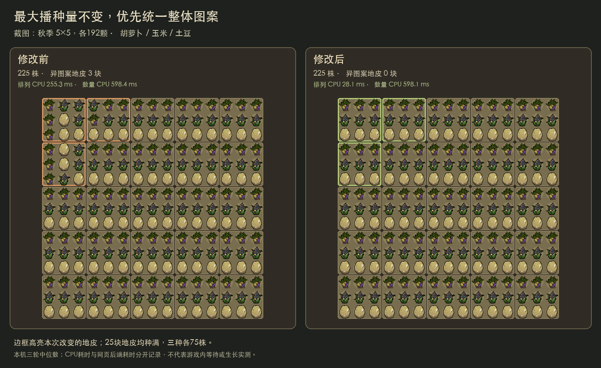
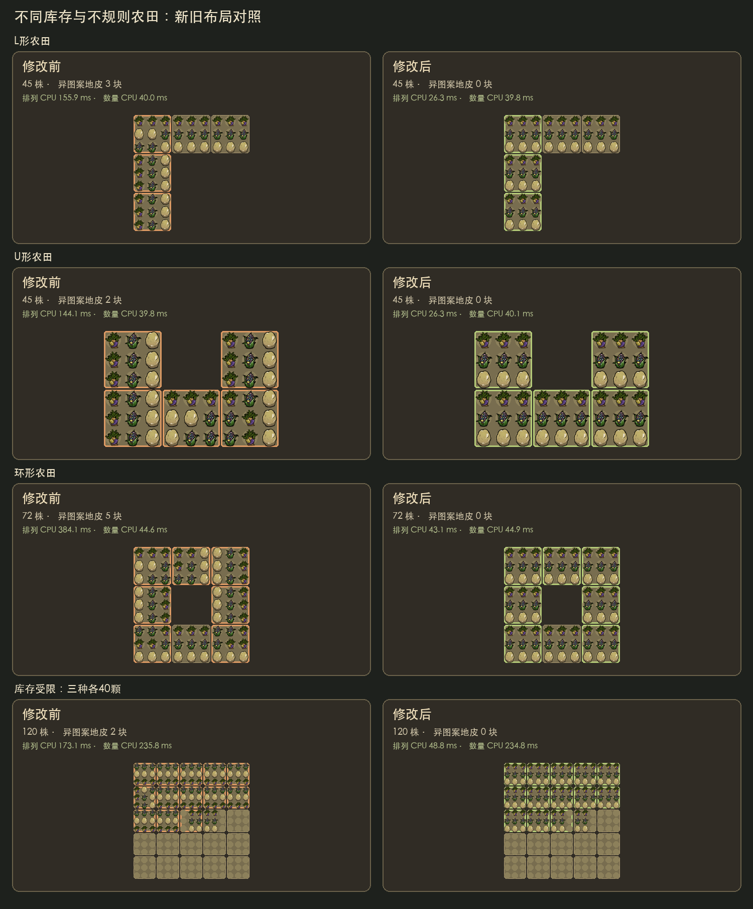

# 整体图案优先：布局与耗时对照

2026-11-17，本地工作区改动，未推送、未打包安装。保留0.5.24版本号；新源码指纹见完整结果。这里的验证由网页适配器执行真实Mod Lua 5.1模块，不是游戏实机或完整生长验证。

## 变更与保证

- 最大数量求解、上界与完整后备证明不变；原版同族、应季、库存、养分和坑距硬条件不变。
- 最终排列使用独立模块 `aom_seed_arrangement.lua`，按 `pattern_mismatch → line_cost → hole_cost → order_cost` 比较。数量构造共用的旧比较器不改，避免改变证明搜索路径。
- 相同作物数量组成的全部地皮参与图案比较，包括不相邻地皮。图案差异为每组所有无序地皮对的逐坑不同数之和除以该组地皮数；0表示同组成地皮全部一致。
- 行列评分优先完整同种行/列、减少行内断裂；单空坑比较其中心偏移，多空坑由图案一致和行列规则整理。4+4中心留空硬规则保留。固定模版策略保持原图，不调用新整理器。
- 先轮流尝试各组统一图案，再处理连通区域、单格和邻格。已达到候选评分下界的组跳过；候选增量维护受影响组的逐坑计数和单格评分。同族距离/分散旧指标只在首尾计算，保留作导出诊断。
- 只在同一地皮内重排，每块地皮的各作物数量和空坑数不变；每个被接受的调整和最终结果均通过全田硬校验。整理达到预算不影响数量证明；仍不承诺全局最整齐。

## 对照方法

修改前源码先冻结；新旧版本通过同一份网页适配器和本机原版作物定义计算，不另写布局算法。20组场景各运行新旧版本3轮，按轮交替先后顺序；取每例中位数。正式测速时没有并行运行回归测试。

19组使用巨大化·最优，另1组为模版策略自动选配对照（原始case ID `locked-template`，没有锁定编号）。覆盖截图5×5、64格、相等/紧缺/不等库存、多作物、4+4、冬夏与L/T/U/环/桥/缺角田。逐例校验了：最大数量证明、实际用量、逐地皮多重集、原版同族、养分、坑距、应季、库存及三轮确定性。

数量和排列为进程CPU毫秒；网页后端耗时沿用 `runner.run().elapsed_ms`，计到Lua结果与源码复验完成，不含后面的独立导出检查。它既不等于CPU，也不代表游戏协程等待时间。

## 结果

19组最优场景全部通过新旧最大数量一致、每种作物用量一致、逐地皮组成一致和硬校验；三轮输出确定。相同组成地皮图案差异全部降至0或保持0。模版对照布局和数量保持不变。

| 场景 | 新旧株数 | 不同于本组主要图案的地皮：前→后 | 排列CPU毫秒：前→后 | 网页后端毫秒：前→后 |
|---|---:|---:|---:|---:|
| 截图5×5、各192 | 225 | 3→0 | 255.3→28.1 | 1219→988 |
| 8×8、各192 | 576 | 3→0 | 694.1→49.0 | 2577→1941 |
| 5×5、三种各40 | 120 | 2→0 | 173.1→48.8 | 769→648 |
| 不等库存尾数、狭长田 | 43 | 0→0 | 159.3→50.8 | 375→269 |
| 九种作物、各40 | 225 | 12→0 | 255.5→83.3 | 2891→2680 |
| 番茄土豆、各100 | 200 | 3→0 | 251.2→10.2 | 825→583 |
| 单格4+4 | 8 | 0→0 | 7.3→7.2 | 18→17 |
| 冬季三种 | 81 | 8→0 | 495.2→28.3 | 683→212 |
| 夏季三种 | 81 | 8→0 | 475.7→26.7 | 656→203 |
| L形 | 45 | 3→0 | 155.9→26.3 | 232→99 |
| T形 | 36 | 0→0 | 39.2→26.4 | 96→82 |
| U形 | 45 | 2→0 | 144.1→26.3 | 217→99 |
| 环形 | 72 | 5→0 | 384.1→43.1 | 499→162 |
| 桥形 | 63 | 2→0 | 292.5→26.9 | 392→127 |
| 缺角21格 | 189 | 3→0 | 213.6→30.0 | 995→818 |
| T形最低库存 | 32 | 0→0 | 87.4→20.3 | 317→251 |
| U形库存尾数 | 35 | 0→0 | 160.1→104.0 | 528→472 |
| 环形紧缺库存 | 50 | 0→0 | 268.2→153.1 | 1480→1422 |
| 春季桥形混合库存 | 60 | 0→0 | 169.8→69.3 | 794→693 |
| 模版策略对照 | 32 | 0→0 | 0.202→0.199 | 51→50 |

19组最优场景各例中位数相加：排列CPU从4681.787降到858.101毫秒，减少81.7%；网页后端从15563降到11766毫秒，减少24.4%。数量CPU从7345.375到7380.295毫秒，增加0.48%，没有数量阶段提速的证据。小单格、数量证明占比大的场景整体收益较小；数据不能推广为所有输入的固定加速比例。





## 回归与证据

- 713项Lua 5.1行为回归、18项发布检查通过，0失败、错误、警告、跳过；[检查结果](selfcheck-validation.json)。
- 网页22项测试通过，其中包含76组最优策略逐坑一致性及模版策略对照；[网页日志](web-tests.log)。
- 前端14项测试通过；[前端日志](web-js-tests.log)。
- 新增5项排列专项在最终版本完整重跑通过，覆盖截图统一、库存/不规则田、独立图案差异计算、逐地皮组成不变和紧凑指标只在首尾计算。实际几何反例验证了“统一图案会破坏同族”时保留必要的不一致；[专项日志](pattern-tests.log)。
- [汇总JSON](summary.json)、[CSV](summary.csv)、[完整三轮输入/坐标/校验/哈希结果](comparison.json.gz)、[产物校验和](artifacts.json)。

`source-before.zip`、`source-after.zip`仅包含验证用Mod Lua源码和modinfo，不含运行美术资源，不是可安装Mod包。复跑时分别解压到独立目录：

```sh
python3 tools/benchmark_seed_arrangement.py --before /tmp/tractor-before --after /tmp/tractor-after --rounds 3 --output outputs/pattern-comparison.json
python3 tools/render_seed_arrangement_comparison.py outputs/pattern-comparison.json --output outputs/pattern-comparison
```

图来自真实计算坐标与原版图标的离线绘制，不是DST客户端截图；尚未验证游戏内FPS、联机显示或最终巨大化生长。
